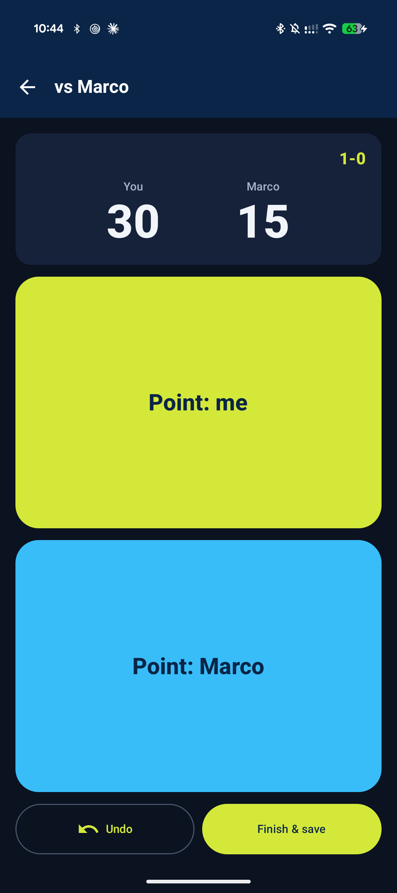
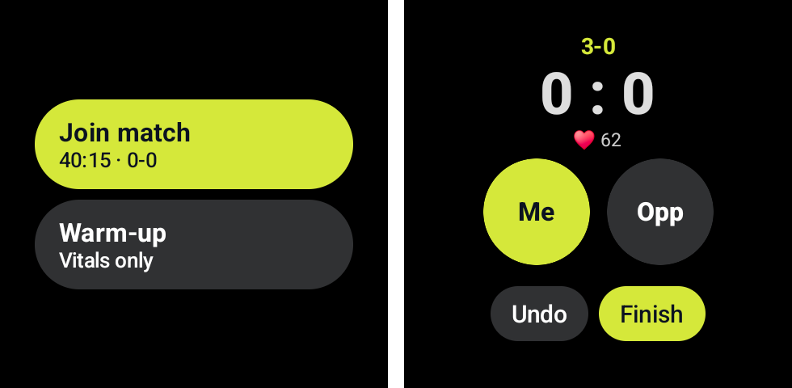

<p align="center">
  
</p>

<h1 align="center">Net Result</h1>

<p align="center"><b>Your tennis matches, set by set. Know your numbers.</b></p>

<p align="center">
  <a href="https://github.com/ESeNonFossiIo/app-netresult/releases/latest"><b>Download the latest version</b></a>
</p>

<p align="center">
  
  
  
</p>

Net Result is a simple, fast tennis match tracker. Log every match you play, watch your win
rate over time and see how you do against each opponent, and score the match live from your phone or your watch.
No account, no ads, no internet connection needed.

## Install on your phone

You need Android 7.0 or newer. The app isn't on the Play Store, so you install it from a file.

1. Open the [latest release](https://github.com/ESeNonFossiIo/app-netresult/releases/latest) on your phone and
   download `netresult-<version>-release.apk`.
2. Open the downloaded file and install it. Android will ask you to allow installing apps from your browser
   or file manager ("install unknown apps"). Allow it for that app.
3. Open **Net Result** and log your first match.

To check that a download is intact, download `SHA256SUMS` from the same release and run
`sha256sum -c SHA256SUMS` in the folder with the files.

### The watch app

The watch app is a separate file in the same release, `netresult-wear-<version>-release.apk`, for Wear OS 3 or newer.
Watches have no browser, so you install it from a computer with
[adb](https://developer.android.com/tools/adb) after turning on **Developer options > ADB debugging** (and
**Wireless debugging**) on the watch:

```bash
adb connect <watch-ip>:<port>        # shown on the watch under Wireless debugging
adb install netresult-wear-<version>-release.apk
```

Keep the phone and watch apps on the same version. The first time you start a match the watch asks for permission
to read your heart rate and activity.

### Updating

Install the new release over the old one. **Your matches and settings are kept.**

If Android refuses with "app not installed" or a signature error, the copy on your phone came from a different
source (for example an early test build). Before you uninstall it, open **Settings > Export data > CSV** and keep
the file. After installing the new version use **Settings > Import data > CSV**.

## What you can do

- **Log a match in seconds.** Pick the date, type (or tap) your opponent, enter each set score
  and add a note if you like. Win, draw or loss is worked out for you.
- **Tie-breaks.** Played a match tie-break instead of a third set (e.g. 10-8)? Tap **TB** on that
  set. It still counts as a set won or lost.
- **Score a match live, on your phone or your watch.** Tap who won each point and the app keeps the tennis score
  (see [Live scoring](#live-scoring-on-your-phone-and-your-watch)).
- **See how you're doing.** The home screen shows matches won, drawn and lost, sets won and
  lost, your set win percentage and your overall win rate, plus your latest matches.
- **Browse your history.** Filter by opponent to see how a rivalry is going, or group matches
  by opponent. The summary at the top follows your filter.
- **Fix mistakes.** Tap any match to change the scores, opponent, date or notes, or delete it.
- **Don't lose a half-finished entry.** Save a draft and pick it up later from the home screen.

## Live scoring on your phone and your watch

<p align="center">
  
</p>

Tap **Live match**, pick your opponent and tap **Point: me** or **Point: <opponent>** after every point. The app
knows tennis: 15, 30, 40, deuce and advantage, a tie-break at 6-6, best of three sets. **Undo** fixes a mis-tap.
The screen stays on while you play, and the match is saved to your history when you finish (or finish early, and
the score so far is kept).

### On your watch (Wear OS)

<p align="center">
  
</p>

Install the watch app too (see below) and the two stay in step: a point scored on the watch shows up on the phone
and the other way round, Undo included. Start a match on either one and the other offers **Join match**. Finish it
on either, and it is saved once.

- **Match** scores the game and records a tennis workout with your heart rate and calories.
- **Warm-up** records the same vitals with no score, for the knock-up before a match.
- If the phone is out of range when you finish, the watch keeps the match and sends it the next time you open the watch app.
- Opponent names are typed on the phone. A match started on the watch is saved as "Opponent"; tap it in History to
  rename it.

To see the workout in **Google Fit**, open **Settings > Health Connect > Allow** on the phone once. Sessions are
written to Health Connect (the replacement for the Google Fit API), and Google Fit and other fitness apps read them
from there. Nothing is sent anywhere else.

## Make it yours

<p align="center">
  
</p>

Open **Settings** (the cog on the home screen) to choose a colour theme:
**Ball**, **Clay**, **Grass** or **Hard court**. The app follows your phone's light and dark
mode.

<p align="center">
  
</p>

Net Result speaks **English, Italiano, Português, Español and Ελληνικά**. Pick your language
from the drop-down in Settings.

## Your data stays yours

Everything is stored privately on your phone. Nothing is uploaded, there is no tracking and the
app never asks for access to your files: backups use Android's own file picker. The phone and watch talk to each
other directly over Bluetooth, and workouts go to Health Connect on your phone only if you allow it.

- **Export** all your matches to a **CSV** (opens in Excel or Google Sheets) or **JSON** file.
- **Import** a file on a new phone, or to merge in matches from somewhere else. Matches that
  are already in the app are skipped, so importing the same file twice is safe.
- **Reset all data** in Settings wipes everything and starts fresh. Export first if you want a
  backup.
- Uninstalling the app deletes its data. Export a CSV first if you want to keep your matches.

## Questions or ideas?

Found a bug or have a suggestion? Please
[open an issue](https://github.com/ESeNonFossiIo/app-netresult/issues).

## Developers

Build and contribution notes are in [DEVELOPING.md](DEVELOPING.md).

## License

MIT, see [LICENSE](LICENSE). Free and open source.
