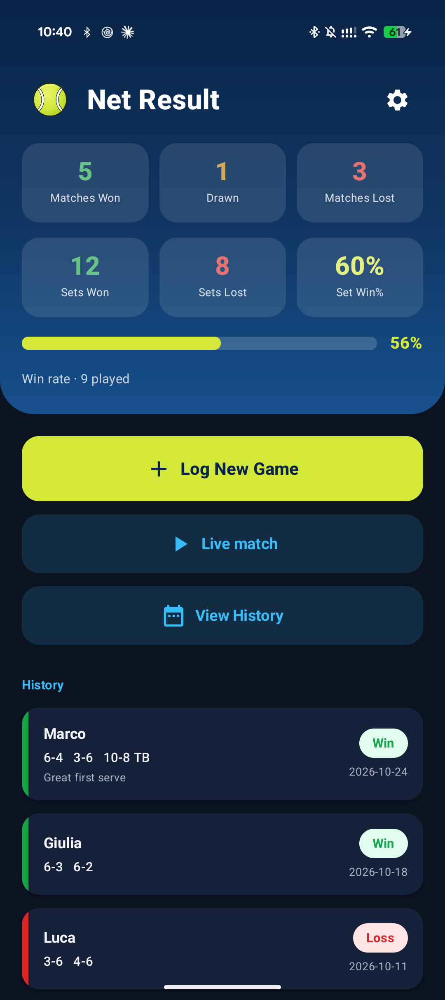
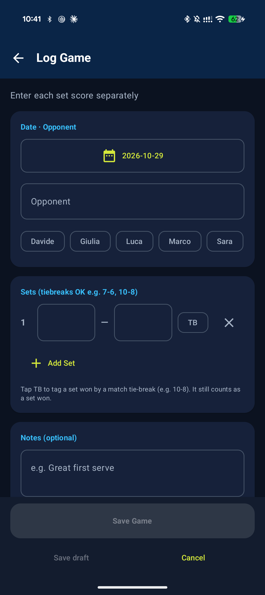
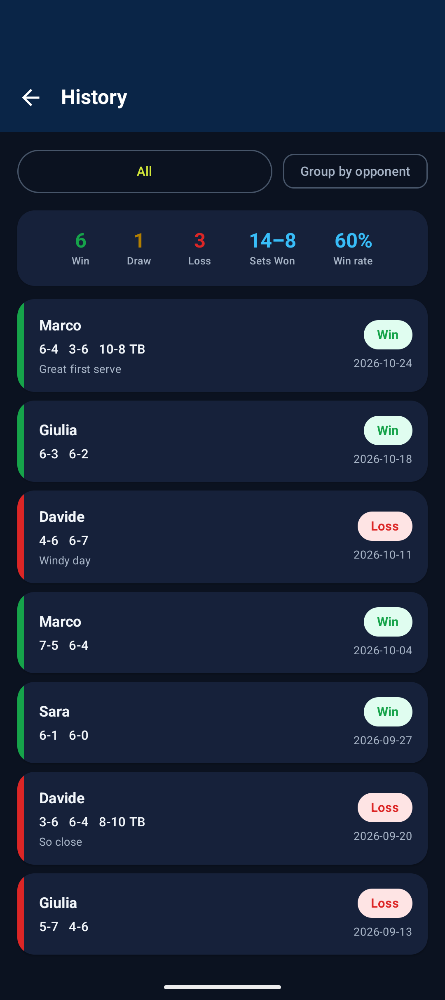
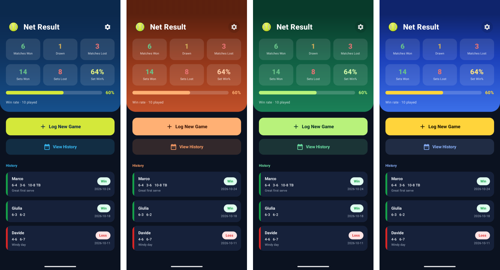
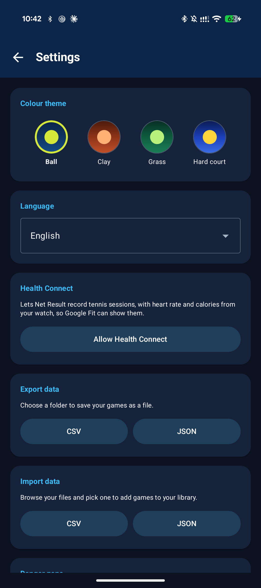

  

<h1 align="center">Net Result</h1>

<b>Your tennis matches, set by set. Know your numbers.</b>

  <a href="https://github.com/ESeNonFossiIo/app-netresult/releases/latest"><b>Download the latest version</b></a>

  
  
  

Net Result is a simple, fast tennis match tracker. Log every match you play, watch your win
rate over time and see how you do against each opponent. No account, no ads, no internet
connection needed.

## Install on your phone

You need Android 7.0 or newer. The app isn't on the Play Store, so you install it from a file.

1. Open the [latest release](https://github.com/ESeNonFossiIo/app-netresult/releases/latest) on your phone and
   download `netresult-<version>-release.apk`.
2. Open the downloaded file and install it. Android will ask you to allow installing apps from your browser
   or file manager ("install unknown apps"). Allow it for that app.
3. Open **Net Result** and log your first match.

To check that a download is intact, download `SHA256SUMS` from the same release and run
`sha256sum -c SHA256SUMS` in the folder with the files.

### Updating

Install the new release over the old one. **Your matches and settings are kept.**

If Android refuses with "app not installed" or a signature error, the copy on your phone came from a different
source (for example an early test build). Before you uninstall it, open **Settings > Export data > CSV** and keep
the file. After installing the new version use **Settings > Import data > CSV**.

## What you can do

- **Log a match in seconds.** Pick the date, type (or tap) your opponent, enter each set score
  and add a note if you like. Win, draw or loss is worked out for you.
- **Tie-breaks.** Played a match tie-break instead of a third set (e.g. 10-8)? Tap **TB** on that
  set. It still counts as a set won or lost.
- **See how you're doing.** The home screen shows matches won, drawn and lost, sets won and
  lost, your set win percentage and your overall win rate, plus your latest matches.
- **Browse your history.** Filter by opponent to see how a rivalry is going, or group matches
  by opponent. The summary at the top follows your filter.
- **Fix mistakes.** Tap any match to change the scores, opponent, date or notes, or delete it.
- **Don't lose a half-finished entry.** Save a draft and pick it up later from the home screen.

## Make it yours

  

Open **Settings** (the cog on the home screen) to choose a colour theme:
**Ball**, **Clay**, **Grass** or **Hard court**. The app follows your phone's light and dark
mode.

  

Net Result speaks **English, Italiano, Português, Español and Ελληνικά**. Pick your language
from the drop-down in Settings.

## Your data stays yours

Everything is stored privately on your phone. Nothing is uploaded, there is no tracking and the
app never asks for access to your files: backups use Android's own file picker.

- **Export** all your matches to a **CSV** (opens in Excel or Google Sheets) or **JSON** file.
- **Import** a file on a new phone, or to merge in matches from somewhere else. Matches that
  are already in the app are skipped, so importing the same file twice is safe.
- **Reset all data** in Settings wipes everything and starts fresh. Export first if you want a
  backup.
- Uninstalling the app deletes its data. Export a CSV first if you want to keep your matches.

## Questions or ideas?

Found a bug or have a suggestion? Please
[open an issue](https://github.com/ESeNonFossiIo/app-netresult/issues).

## Developers

Build and contribution notes are in [DEVELOPING.md](DEVELOPING.md).

## License

MIT, see [LICENSE](LICENSE). Free and open source.
